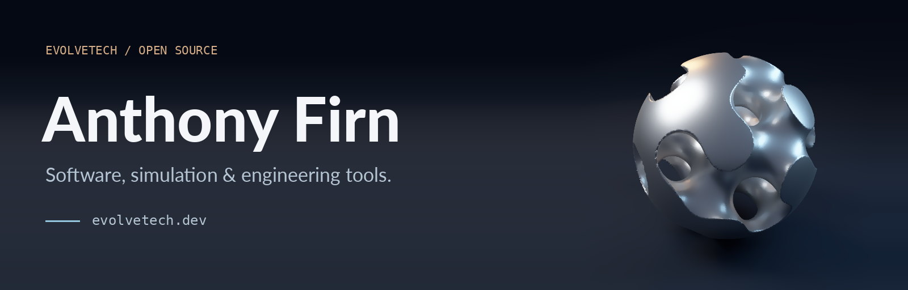
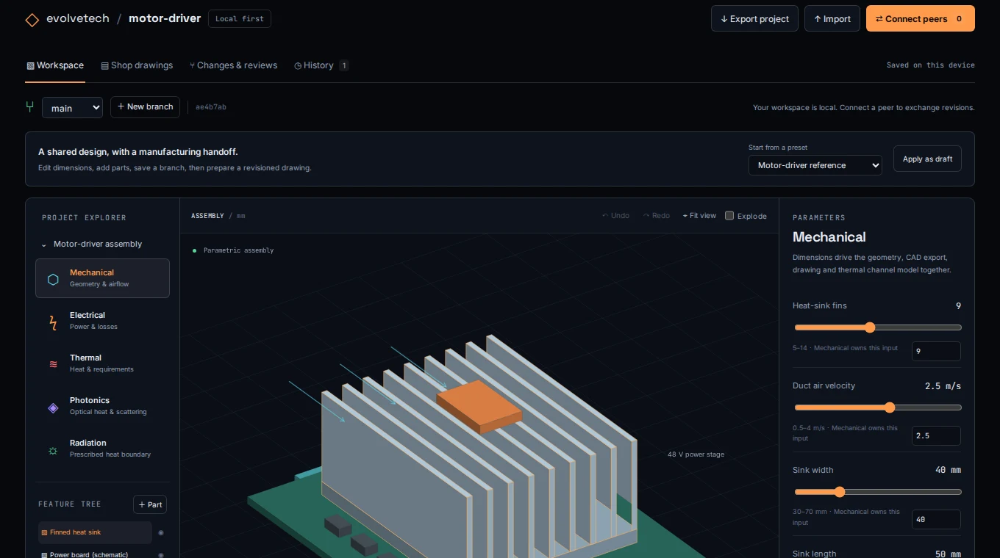
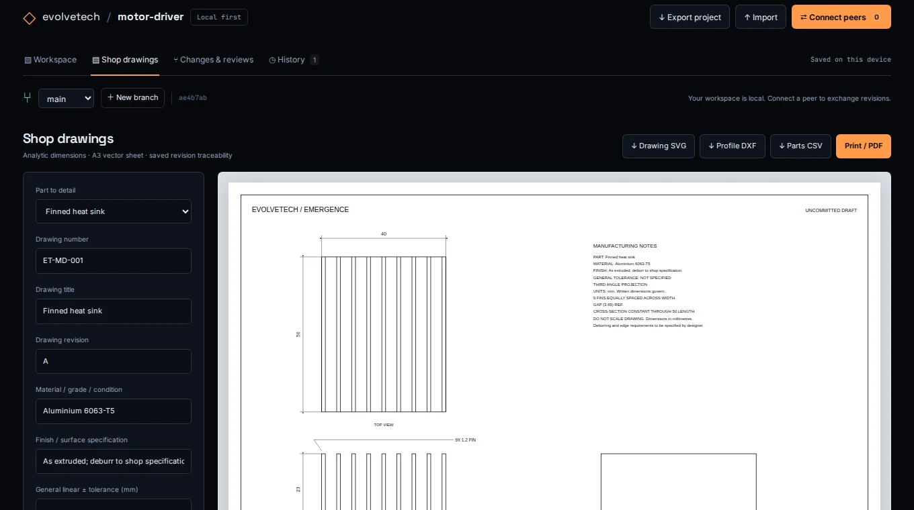
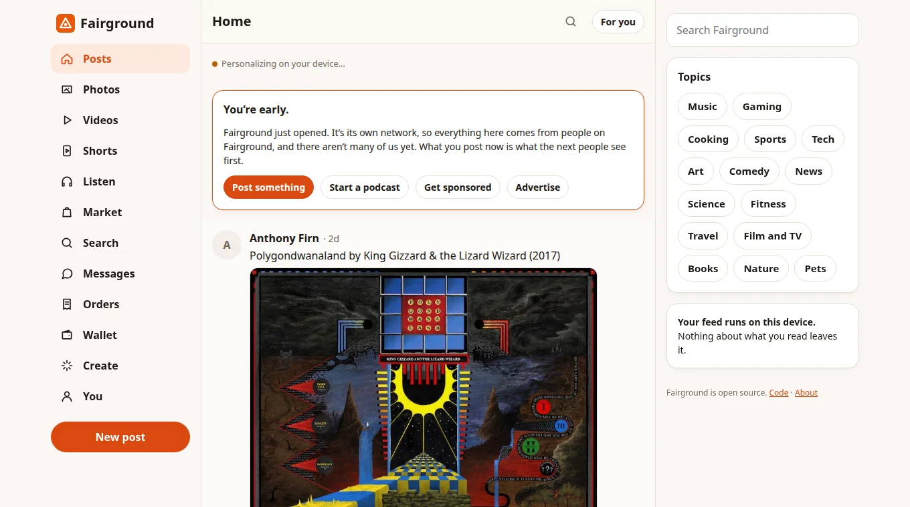
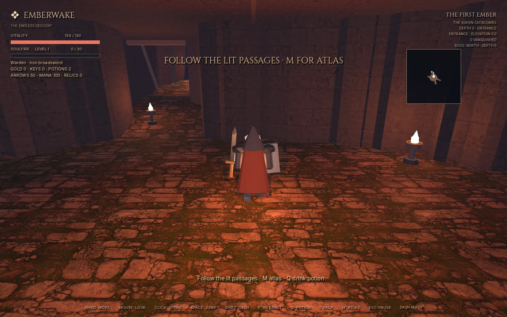

<a href="https://www.evolvetech.dev/">
  <picture>
    <source media="(max-width: 600px)" srcset="assets/profile-header-mobile.png">
    
  </picture>
</a>

  <a href="https://www.evolvetech.dev/">Portfolio &amp; live demos</a> &nbsp; · &nbsp;
  <a href="https://www.evolvetech.dev/resume/">Résumé</a> &nbsp; · &nbsp;
  <a href="mailto:anthony@evolvetech.dev">Email</a> &nbsp; · &nbsp;
  <a href="https://www.evolvetech.dev/play/fairground/#/about">Support the projects</a>

I'm a lead software engineer at **True Native Media** and build open-source projects through **EvolveTech**. My work spans full-stack products, cloud infrastructure and AI tooling, with a computer engineering background in hardware, firmware and precision manufacturing.

I'm interested in tools that let people inspect, build and experiment: a shared CAD design, a physics model with an error estimate, or a game you can play in your browser. **Open to remote engineering roles.**

## Selected work

### [Emergence](https://github.com/anthony-firn/emergence) · simulation and collaborative CAD

A shared engineering workspace with parametric parts, branches and reviews, electrical and thermal checks, and dimensioned mechanical shop drawings. The native research engine covers fluids, optics, heat, materials, geometry, rendering and chip design.

`Rust` `WebAssembly` `WebRTC` `CAD`

[Open CAD](https://www.evolvetech.dev/play/emergence/cad/) · [Run the physics lab](https://www.evolvetech.dev/play/emergence/) · [Source](https://github.com/anthony-firn/emergence)

Engineering workflow, drawings and current scope

A model can report its cost, validity indicator and error claim; the engine uses those to select an appropriate level of detail. Reference comparisons, unmet tolerances and modeling assumptions are part of the result. The Rust workspace has CPU reference implementations and optional CUDA backends, with benchmarks and limitations for each domain. The browser lab compiles selected native models to WebAssembly and runs them in a Worker.

The collaborative CAD prototype includes:

- Parametric cooling geometry and additional box/cylinder parts, with selection, placement and undo/redo.
- Shared mechanical, electrical and thermal inputs evaluated by the Rust project graph. Prescribed absorbed optical power and external heat enter the thermal boundary model.
- Content-addressed revisions, branches, reviews and explicit merge conflicts for parameters, parts and drawing metadata.
- Browser-tab sync, manually paired WebRTC connections and portable project files that retain committed history.
- A3 mechanical drawing sheets with dimensioned orthographic views, first/third-angle projection, material and finish fields, general tolerances and revision/checker information.
- Vector SVG/PDF, analytic DXF profiles, native CAD STL and mechanical parts CSV exports.

General sketch constraints, STEP/B-rep editing, GD&T authoring, PCB fabrication packages and persistent peer discovery remain unfinished. The manufacturing handoff covers the supported mechanical shapes and still needs qualification against actual shop workflows.

[Methods and current scope](https://github.com/anthony-firn/emergence/blob/main/analysis/collaborative_cad.md)

### [Fairground](https://github.com/anthony-firn/fairground) · decentralized social and creator payments

A social app with independent Nostr relays, feed ranking on the reader's device, and direct creator payments. Posts, media, podcasts, sponsorships and a marketplace share a React/TypeScript codebase for the browser, iOS and Android.

`React` `TypeScript` `Nostr` `Algorand`

[Try Fairground](https://www.evolvetech.dev/play/fairground/) · [Source and protocol](https://github.com/anthony-firn/fairground)

Payments, protocol and operating requirements

Fairground includes signed sponsorship agreements, direct wallet-to-wallet USDC payments on Algorand, creator support, encrypted messages and a podcast gateway for standard RSS distribution. Contract events carry Schnorr and ML-DSA-65 signatures. The repository documents the protocol, implementation and payment-hosting requirements.

It is an early release. Payment integrations and gateways have their own operating requirements; the static social client and distributed event storage are separate from those integrations.

### [Emberwake](https://github.com/anthony-firn/emberwake) · a playable action roguelike

Procedural dungeons, third-person combat, several starting classes, equipment, enemy roles, bosses and vertical traversal. Built with Godot and Blender, with procedural character animation.

`Godot` `GDScript` `Blender`

[Play Emberwake](https://www.evolvetech.dev/play/emberwake/) · [Source](https://github.com/anthony-firn/emberwake)

Game testing and animation

The project has a TCP agent bridge for automated playtesting alongside native smoke and recovery tests. Character animation is procedural, and the playable browser build includes the current dungeon geometry, combat, equipment and traversal systems.

## More to explore

| Project | Try it |
| --- | --- |
| [Emergence physics lab](https://github.com/anthony-firn/emergence) | [Compare optical models, evolve a fluid and inspect a cooling design](https://www.evolvetech.dev/play/emergence/), with uncertainty and model-validity checks. |
| [Retirement Research](https://github.com/anthony-firn/retirement-research) | [Explore published retirement strategy results](https://www.evolvetech.dev/play/retirement/) by spendable income, taxes and failure risk. Python and PyTorch/CUDA research. |
| [Symmetry Forge](https://github.com/anthony-firn/symmetry-forge) | [Compute graph automorphisms](https://www.evolvetech.dev/play/symmetry-forge/) and explore symmetry groups with Python running in the browser. |
| [Evolve Inbox](https://github.com/anthony-firn/evolve-inbox) | [Try a custom-domain email reader](https://www.evolvetech.dev/play/evolve-inbox/) with fictional messages, attachments and reported sender checks. |
| [Pulse Pop](https://github.com/anthony-firn/pulse-pop) | [Play the touch game](https://www.evolvetech.dev/play/pulse-pop/): timed pulses, combos and cosmetic progression from one Expo codebase for web, iOS and Android. |

Research methods, developer tools and hosting

**Retirement Research** studies withdrawals, taxes, rebalancing and market uncertainty. Published comparisons include 2,000 reshuffled 40-year market histories and stress cases. The browser explorer presents those results; the repository documents the data pipeline, assumptions and research limitations.

**Symmetry Forge** uses partition refinement and exhaustive search to study graph automorphisms and combinatorial designs. The browser lab runs the Python package through Pyodide in a cancellable Worker, with the Petersen graph and the 4D hypercube as checks.

**Evolve Inbox** receives custom-domain email through inbound webhooks and Netlify Blobs storage. Its password-protected reader handles formatted mail, plain text, attachments and sender-check results. The public demo uses fictional mail. Sending and multi-user mailbox administration are outside its current scope.

**Pulse Pop** separates game rules from rendering, and the same Expo/React Native application exports to the browser.

The [portfolio](https://github.com/anthony-firn/evolvetech.dev) is buildless HTML/CSS/JavaScript with self-hosted fonts and prebuilt browser demos. Its animated hypercube uses WebGL with a Canvas fallback, bounded pixel budgets, a frame-rate ceiling, reduced-motion support and offscreen/hidden pause behavior. [Measurements and browser checks](https://github.com/anthony-firn/evolvetech.dev/blob/main/PERFORMANCE.md) document the rendering tradeoffs.

GitHub Actions publishes the same static release to Netlify and Bunny. A scheduled monitor checks both providers and manages DNS failover and recovery; DNS-validated certificates keep HTTPS available on both copies.

Earlier work includes [CPU/FPGA communication examples](https://github.com/anthony-firn/CPU-FPGA-Tutorial), [LLM infrastructure with Terraform and vLLM](https://github.com/anthony-firn/deepseek-orchestrator), and [RLWE hardware design](https://github.com/anthony-firn/RLWE-HDL-Secure).

## Engineering background

At **True Native Media**, I lead development of AdVero, the campaign workspace used by podcast shows, advertisers and staff. My work includes campaign-planning services, inventory and quote pipelines, data synchronization and cloud infrastructure. I use Cloud Run, Firestore, BigQuery, Airtable and Terraform, with audits and health checks for the production workflows.

Previously, at **MedSpark**, I worked across hardware design, firmware, software and server infrastructure for medical product development. The manufacturing work included precision wire EDM machining.

I have a **B.S. in Computer Engineering from California Polytechnic State University, San Luis Obispo**.

## Technical toolkit

| Area | Tools I work with |
| --- | --- |
| Languages | Python, Rust, TypeScript, JavaScript, SQL, GDScript, Bash, Verilog |
| Web and mobile | React, Next.js, FastAPI, React Native, Expo, Capacitor, Apps Script |
| Cloud and operations | Google Cloud, Cloud Run, Pub/Sub, AWS, Terraform, GitHub Actions, Netlify, Bunny CDN |
| Data and AI | BigQuery, Firestore, Airtable, NumPy, PyTorch/CUDA, vLLM, LLM agents, MCP |
| Simulation and graphics | Rust CPU models, WebAssembly, Web Workers, Godot, Blender, WebGL, Canvas, Pyodide |
| Hardware and manufacturing | Firmware, FPGA/HDL work, CAD workflows and precision wire EDM |

For engineering roles or collaboration: [anthony@evolvetech.dev](mailto:anthony@evolvetech.dev).

[Portfolio](https://www.evolvetech.dev/) · [Résumé](https://www.evolvetech.dev/resume/) · [Support open-source development](https://www.evolvetech.dev/play/fairground/#/about) · [Render source](ARTWORK.md)
