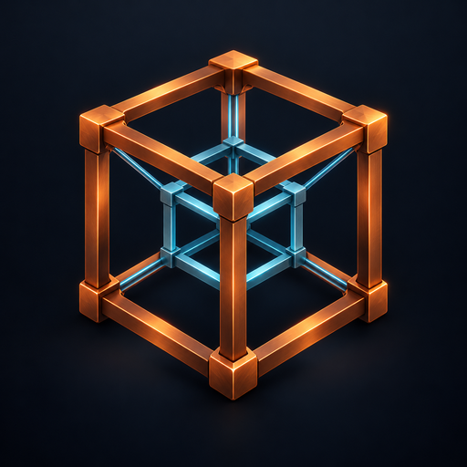

# Anthony Firn

Lead software engineer working across full-stack products, cloud infrastructure, AI tooling, simulation and graphics. I build open-source projects through **EvolveTech** and publish browser demos so people can try the work.

My background is in computer engineering, with experience in hardware, firmware, software and precision manufacturing. That combination shapes projects like Emergence: geometry, physical models and the requirements someone needs to manufacture a part belong in the same engineering workflow.

[Portfolio and live demos](https://www.evolvetech.dev/) · [Résumé](https://www.evolvetech.dev/resume/) · [Email](mailto:anthony@evolvetech.dev)

Open to remote engineering roles. My work spans product development, platform engineering, scientific computing and tools for other engineers.

 

## Try the projects

| Project | What you can try | Source |
| --- | --- | --- |
| [Emergence CAD](https://www.evolvetech.dev/play/emergence/cad/) | Edit a shared engineering design, add parts, branch and review changes, run electrical/thermal checks and prepare mechanical shop drawings. | [emergence](https://github.com/anthony-firn/emergence) |
| [Emergence physics lab](https://www.evolvetech.dev/play/emergence/) | Compare optical models, evolve a fluid and inspect a cooling design with uncertainty and model-validity checks. | [emergence](https://github.com/anthony-firn/emergence) |
| [Fairground](https://www.evolvetech.dev/play/fairground/) | Explore a decentralized social app with local AI feed ranking, creator payments, podcasts and a marketplace. | [fairground](https://github.com/anthony-firn/fairground) |
| [Emberwake](https://www.evolvetech.dev/play/emberwake/) | Play a third-person action roguelike with procedural dungeons, combat, equipment and vertical traversal. | [emberwake](https://github.com/anthony-firn/emberwake) |
| [Retirement Research](https://www.evolvetech.dev/play/retirement/) | Compare published retirement strategy results by spendable income, taxes and failure risk. | [retirement-research](https://github.com/anthony-firn/retirement-research) |
| [Evolve Inbox](https://www.evolvetech.dev/play/evolve-inbox/) | Try a custom-domain email reader with fictional messages, attachments and reported sender checks. | [evolve-inbox](https://github.com/anthony-firn/evolve-inbox) |
| [Symmetry Forge](https://www.evolvetech.dev/play/symmetry-forge/) | Compute graph automorphisms and explore familiar symmetry groups with Python running in the browser. | [symmetry-forge](https://github.com/anthony-firn/symmetry-forge) |
| [Pulse Pop](https://www.evolvetech.dev/play/pulse-pop/) | Play a touch game built from one Expo codebase for web, iOS and Android. | [pulse-pop](https://github.com/anthony-firn/pulse-pop) |

## Emergence: simulation, collaborative CAD and manufacturing handoff

[Emergence](https://github.com/anthony-firn/emergence) is a Rust research workspace for simulation and engineering design. A model can report its cost, validity indicator and error claim; the engine uses those to select an appropriate level of detail. Reference comparisons, unmet tolerances and modeling assumptions are part of the result.

The native workspace covers fluids, optics, heat, materials, geometry, rendering, chip design and engineering project graphs, with CPU reference implementations and optional CUDA backends. Each domain has its own benchmarks and limitations. The browser lab compiles selected native models to WebAssembly and runs them in a Worker.

The collaborative CAD prototype adds a shared design workflow:

- Parametric cooling geometry and additional box/cylinder parts, with selection, placement and undo/redo.
- Shared mechanical, electrical and thermal inputs evaluated by the Rust project graph. Prescribed absorbed optical power and external heat enter the thermal boundary model.
- Content-addressed revisions, branches, reviews and explicit merge conflicts for parameters, parts and drawing metadata.
- Browser-tab sync, manually paired WebRTC connections and portable project files that retain committed history.
- A3 mechanical drawing sheets with dimensioned orthographic views, first/third-angle projection, material and finish fields, general tolerances and revision/checker information.
- Vector SVG/PDF, analytic DXF profiles, native CAD STL and mechanical parts CSV exports.

General sketch constraints, STEP/B-rep editing, GD&T authoring, PCB fabrication packages and persistent peer discovery remain unfinished. The current manufacturing handoff covers the supported mechanical shapes and still needs qualification against actual shop workflows.

[Open CAD](https://www.evolvetech.dev/play/emergence/cad/) · [Run the physics lab](https://www.evolvetech.dev/play/emergence/) · [Methods and current scope](https://github.com/anthony-firn/emergence/blob/main/analysis/collaborative_cad.md)

## Fairground: decentralized social and direct creator payments

[Fairground](https://github.com/anthony-firn/fairground) combines social posts, media, podcasts, sponsorships and a marketplace. Signed events live on independent Nostr relays, and feed ranking runs on the reader's device. The app has a shared React/TypeScript codebase for the browser, iOS and Android.

The project includes signed sponsorship agreements, direct wallet-to-wallet USDC payments on Algorand, creator support, encrypted messages and a podcast gateway for standard RSS distribution. Contract events carry Schnorr and ML-DSA-65 signatures. The protocol, implementation and payment-hosting requirements are documented in the repository.

It is an early release. Payment integrations and gateways have their own operating requirements; the static social client and distributed event storage are separate from those integrations.

[Try Fairground](https://www.evolvetech.dev/play/fairground/) · [Source and protocol](https://github.com/anthony-firn/fairground)

## Games and interactive graphics

[Emberwake](https://github.com/anthony-firn/emberwake) is a playable Godot/Blender action-roguelike prototype. Its current browser build includes procedural dungeon geometry, a third-person camera, several starting classes, equipment, enemy roles, bosses and vertical traversal. Character animation is procedural, and the project has a TCP agent bridge for automated playtesting alongside native smoke and recovery tests.

[Play Emberwake](https://www.evolvetech.dev/play/emberwake/)

[Pulse Pop](https://github.com/anthony-firn/pulse-pop) is a smaller Expo/React Native game: touch controls, timed pulses, combos and cosmetic progression. Its game rules are separated from rendering, and the same application exports to the browser.

The portfolio's animated hypercube uses WebGL with a Canvas fallback. Its renderer has bounded pixel budgets, a frame-rate ceiling, reduced-motion support and offscreen/hidden pause behavior. [The measurements and browser checks](https://github.com/anthony-firn/evolvetech.dev/blob/main/PERFORMANCE.md) document the rendering tradeoffs.

## Research and developer tools

[Retirement Research](https://github.com/anthony-firn/retirement-research) uses Python and PyTorch/CUDA to study withdrawals, taxes, rebalancing and market uncertainty. Published comparisons include 2,000 reshuffled 40-year market histories and stress cases. The browser explorer presents those results; the repository documents the data pipeline, assumptions and research limitations.

[Symmetry Forge](https://github.com/anthony-firn/symmetry-forge) explores graph automorphisms and combinatorial designs using partition refinement and exhaustive search. The browser lab runs the Python package through Pyodide in a cancellable Worker, with known groups such as the Petersen graph and the 4D hypercube as checks.

[Evolve Inbox](https://github.com/anthony-firn/evolve-inbox) is a receiving inbox for custom-domain email. Inbound webhooks feed Netlify Blobs storage; a password-protected reader handles formatted mail, plain text, attachments and sender-check results. Its public demo uses fictional mail. Sending and multi-user mailbox administration are outside its current scope.

Earlier repositories include [CPU/FPGA communication examples](https://github.com/anthony-firn/CPU-FPGA-Tutorial), [LLM infrastructure with Terraform and vLLM](https://github.com/anthony-firn/deepseek-orchestrator), and [RLWE hardware design](https://github.com/anthony-firn/RLWE-HDL-Secure).

## Engineering background

At **True Native Media**, I lead development of AdVero, the campaign workspace used by podcast shows, advertisers and staff. My work includes campaign-planning services, inventory and quote pipelines, data synchronization and cloud infrastructure. I use Cloud Run, Firestore, BigQuery, Airtable and Terraform, with audits and health checks for the production workflows.

Previously, at **MedSpark**, I worked across hardware design, firmware, software and server infrastructure for medical product development. The manufacturing work included precision wire EDM machining.

I have a **B.S. in Computer Engineering from California Polytechnic State University, San Luis Obispo**.

## Technical toolkit

| Area | Tools I work with |
| --- | --- |
| Languages | Python, Rust, TypeScript, JavaScript, SQL, GDScript, Bash, Verilog |
| Web and mobile | React, Next.js, FastAPI, React Native, Expo, Capacitor, Apps Script |
| Cloud and operations | Google Cloud, Cloud Run, Pub/Sub, AWS, Terraform, GitHub Actions, Netlify, Bunny CDN |
| Data and AI | BigQuery, Firestore, Airtable, NumPy, PyTorch/CUDA, vLLM, LLM agents, MCP |
| Simulation and graphics | Rust CPU models, WebAssembly, Web Workers, Godot, Blender, WebGL, Canvas, Pyodide |
| Hardware and manufacturing | Firmware, FPGA/HDL work, CAD workflows and precision wire EDM |

## How the portfolio runs

[evolvetech.dev](https://github.com/anthony-firn/evolvetech.dev) is buildless HTML/CSS/JavaScript with self-hosted fonts and prebuilt browser demos. GitHub Actions publishes the same static release to Netlify and Bunny. A scheduled monitor checks both providers and manages DNS failover and recovery; DNS-validated certificates keep HTTPS available on both copies.

The repositories include implementation details, tests and limitations so another engineer can inspect how the demos work and reproduce the relevant checks.

## Contact

For engineering roles or collaboration: [anthony@evolvetech.dev](mailto:anthony@evolvetech.dev).

[Portfolio](https://www.evolvetech.dev/) · [Résumé](https://www.evolvetech.dev/resume/) · [Support open-source development](https://www.evolvetech.dev/play/fairground/#/about)
